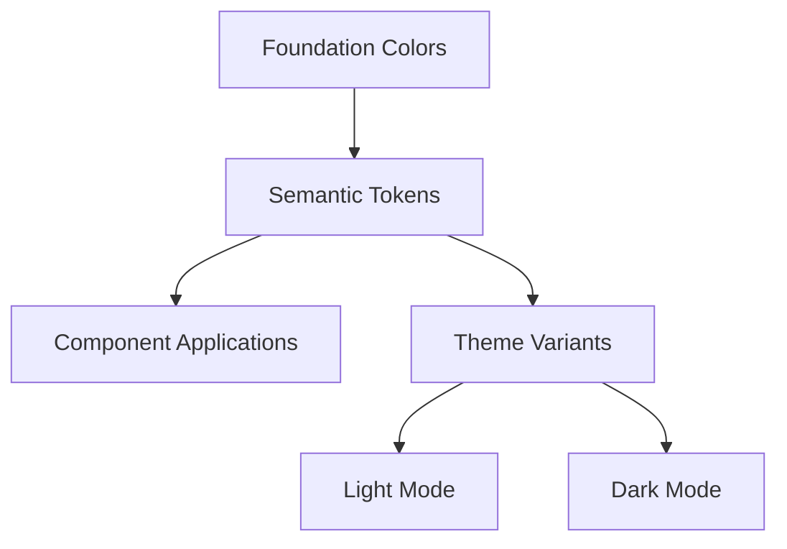

# Design Document: Modern Color Palette

## Overview

This design implements a comprehensive modern color palette system for the entire application, replacing the current monochromatic theme with a vibrant, accessible, and cohesive color scheme. The design leverages CSS custom properties and Tailwind CSS to create a maintainable and scalable color system that supports both light and dark modes while ensuring WCAG 2.1 AA compliance.

## Architecture

The color system follows a three-tier architecture:

1. **Foundation Layer**: Base color values defined as HSL values in CSS custom properties
2. **Semantic Layer**: Meaningful color tokens that map to specific UI purposes (primary, secondary, success, etc.)
3. **Component Layer**: Component-specific color applications using semantic tokens



## Components and Interfaces

### Color System Interface

The color system exposes the following semantic categories:

- **Brand Colors**: Primary and secondary brand colors with variants
- **Neutral Colors**: Grayscale palette for backgrounds, borders, and text
- **Semantic Colors**: Success, warning, error, and info colors
- **Interactive Colors**: Hover, active, and focus states
- **Surface Colors**: Card, popover, and modal backgrounds

### Theme Configuration

```typescript
interface ColorTheme {
  primary: ColorScale
  secondary: ColorScale
  accent: ColorScale
  neutral: ColorScale
  semantic: {
    success: ColorScale
    warning: ColorScale
    error: ColorScale
    info: ColorScale
  }
  surface: {
    background: string
    card: string
    popover: string
  }
}

interface ColorScale {
  50: string
  100: string
  // ... through 900
  DEFAULT: string
  foreground: string
}
```

## Data Models

### Modern Color Palette Specification

**Primary Brand Colors**:
- Primary: Vibrant blue (#3B82F6) - Modern, trustworthy, professional
- Primary variants: 50-900 scale for different use cases
- High contrast foreground colors for accessibility

**Secondary Colors**:
- Secondary: Sophisticated purple (#8B5CF6) - Creative, innovative
- Accent: Energetic orange (#F59E0B) - Call-to-action, highlights

**Neutral Palette**:
- Warm grays with subtle blue undertones
- Better visual hierarchy than pure grays
- Maintains readability across all contexts

**Semantic Colors**:
- Success: Fresh green (#10B981) - Positive actions, confirmations
- Warning: Amber (#F59E0B) - Cautions, important notices  
- Error: Modern red (#EF4444) - Errors, destructive actions
- Info: Cyan (#06B6D4) - Information, tips

**Surface Colors**:
- Background: Clean whites/dark grays with subtle warmth
- Card: Elevated surfaces with proper contrast
- Border: Subtle definition without harsh lines

### Color Values

**Light Mode Palette**:
```css
:root {
  /* Primary Brand */
  --primary-50: 239 246 255;
  --primary-100: 219 234 254;
  --primary-500: 59 130 246;
  --primary-600: 37 99 235;
  --primary-900: 30 58 138;
  --primary: var(--primary-600);
  --primary-foreground: 255 255 255;

  /* Secondary */
  --secondary-50: 245 243 255;
  --secondary-500: 139 92 246;
  --secondary: var(--secondary-500);
  --secondary-foreground: 255 255 255;

  /* Accent */
  --accent-50: 255 251 235;
  --accent-500: 245 158 11;
  --accent: var(--accent-500);
  --accent-foreground: 255 255 255;

  /* Neutrals */
  --neutral-50: 248 250 252;
  --neutral-100: 241 245 249;
  --neutral-200: 226 232 240;
  --neutral-300: 203 213 225;
  --neutral-400: 148 163 184;
  --neutral-500: 100 116 139;
  --neutral-600: 71 85 105;
  --neutral-700: 51 65 85;
  --neutral-800: 30 41 59;
  --neutral-900: 15 23 42;

  /* Semantic */
  --success: 16 185 129;
  --success-foreground: 255 255 255;
  --warning: 245 158 11;
  --warning-foreground: 255 255 255;
  --error: 239 68 68;
  --error-foreground: 255 255 255;
  --info: 6 182 212;
  --info-foreground: 255 255 255;

  /* Surfaces */
  --background: 255 255 255;
  --foreground: 15 23 42;
  --card: 255 255 255;
  --card-foreground: 15 23 42;
  --popover: 255 255 255;
  --popover-foreground: 15 23 42;
  --muted: 248 250 252;
  --muted-foreground: 100 116 139;
  --border: 226 232 240;
  --input: 226 232 240;
  --ring: 59 130 246;
}
```

**Dark Mode Palette**:
```css
.dark {
  /* Primary Brand */
  --primary: 96 165 250;
  --primary-foreground: 15 23 42;

  /* Secondary */
  --secondary: 168 85 247;
  --secondary-foreground: 15 23 42;

  /* Accent */
  --accent: 251 191 36;
  --accent-foreground: 15 23 42;

  /* Semantic */
  --success: 34 197 94;
  --success-foreground: 15 23 42;
  --warning: 251 191 36;
  --warning-foreground: 15 23 42;
  --error: 248 113 113;
  --error-foreground: 15 23 42;
  --info: 34 211 238;
  --info-foreground: 15 23 42;

  /* Surfaces */
  --background: 15 23 42;
  --foreground: 248 250 252;
  --card: 30 41 59;
  --card-foreground: 248 250 252;
  --popover: 30 41 59;
  --popover-foreground: 248 250 252;
  --muted: 51 65 85;
  --muted-foreground: 148 163 184;
  --border: 51 65 85;
  --input: 51 65 85;
  --ring: 96 165 250;
}
```

## Correctness Properties

*A property is a characteristic or behavior that should hold true across all valid executions of a system—essentially, a formal statement about what the system should do. Properties serve as the bridge between human-readable specifications and machine-verifiable correctness guarantees.*

### Property Reflection

After analyzing all acceptance criteria, several properties can be consolidated to eliminate redundancy:
- Properties 3.1 and 3.2 both test for absence of hardcoded colors and can be combined
- Properties 4.1, 4.2, 4.3, 4.4, and 4.5 all test page-level color consistency and can be combined into one comprehensive property
- Properties 2.1 and 2.2 both test centralized configuration and can be combined

### Core Properties

**Property 1: Complete Color System Structure**
*For any* color system configuration, it should define all required color categories (primary, secondary, accent, neutral, semantic) with their respective variants and foreground colors
**Validates: Requirements 1.1**

**Property 2: Theme Mode Completeness**
*For any* color token defined in light mode, there should be a corresponding token defined in dark mode with appropriate contrast adjustments
**Validates: Requirements 1.3**

**Property 3: WCAG Contrast Compliance**
*For any* text-background color combination used in the application, the contrast ratio should meet or exceed WCAG 2.1 AA requirements (4.5:1 for normal text, 3:1 for large text)
**Validates: Requirements 1.5**

**Property 4: Centralized Color Configuration**
*For any* color value used in the application, it should be defined in the centralized theme configuration (Tailwind config and CSS custom properties) and not hardcoded in components
**Validates: Requirements 2.1, 2.2, 3.1, 3.2**

**Property 5: Semantic Color Naming**
*For any* color token in the theme configuration, it should follow semantic naming conventions (primary, secondary, success, warning, error, etc.) rather than descriptive names (blue, red, etc.)
**Validates: Requirements 2.3**

**Property 6: CSS Custom Properties Implementation**
*For any* color in the system, it should be implemented as a CSS custom property that can be dynamically updated for theme switching
**Validates: Requirements 2.4**

**Property 7: Component Color Token Usage**
*For any* component in the application, it should exclusively use color tokens from the theme system and contain no hardcoded color values
**Validates: Requirements 3.1, 3.2, 3.5**

**Property 8: Interactive State Color Definitions**
*For any* interactive UI element (buttons, links, form inputs), it should have defined color states for hover, active, and focus interactions
**Validates: Requirements 1.4, 3.3, 3.4**

**Property 9: Application-Wide Color Consistency**
*For any* page or component in the application, it should use colors exclusively from the defined color system
**Validates: Requirements 1.2, 4.1, 4.2, 4.3, 4.4, 4.5**

**Property 10: Smooth Color Transitions**
*For any* interactive element with color state changes, it should have defined CSS transitions with consistent duration and easing functions
**Validates: Requirements 5.1, 5.2, 5.3**

**Property 11: Motion-Sensitive Accessibility**
*For any* color animation or transition, it should respect the prefers-reduced-motion media query to avoid accessibility issues
**Validates: Requirements 5.4**

**Property 12: Loading State Color Feedback**
*For any* loading or progress indicator, it should use appropriate colors from the semantic color system to provide clear visual feedback
**Validates: Requirements 5.5**

## Error Handling

### Color Fallback Strategy

**Missing Color Tokens**: If a color token is not defined, the system should fall back to a neutral color rather than breaking the interface.

**Invalid Color Values**: CSS custom properties with invalid values should gracefully degrade to browser defaults.

**Theme Switching Errors**: If theme switching fails, the application should maintain the current theme rather than displaying broken colors.

### Accessibility Safeguards

**Contrast Ratio Failures**: Implement runtime contrast checking in development mode to catch accessibility violations.

**Color Blindness Support**: Ensure semantic meaning is not conveyed through color alone, using additional visual indicators.

**High Contrast Mode**: Support system-level high contrast preferences through CSS media queries.

## Testing Strategy

### Dual Testing Approach

The testing strategy combines unit tests for specific color implementations with property-based tests for universal color system properties:

**Unit Tests**:
- Verify specific color values match design specifications
- Test theme switching functionality with concrete examples
- Validate individual component color applications
- Test accessibility features like high contrast mode
- Verify CSS custom property definitions

**Property-Based Tests**:
- Generate random color combinations and verify contrast ratios
- Test color token consistency across all components
- Validate semantic naming conventions across the entire color system
- Verify theme completeness by checking light/dark mode parity
- Test interactive state color definitions across all UI elements

### Property-Based Testing Configuration

- **Testing Library**: Use Jest with custom color testing utilities
- **Minimum Iterations**: 100 iterations per property test
- **Test Tags**: Each property test must reference its design document property
- **Tag Format**: **Feature: modern-color-palette, Property {number}: {property_text}**

### Testing Tools and Utilities

**Color Analysis Tools**:
- Contrast ratio calculation utilities
- Color token extraction from CSS
- Component color usage analysis
- Theme completeness validation

**Accessibility Testing**:
- WCAG compliance checking
- Color blindness simulation
- High contrast mode validation
- Motion preference respect verification

### Integration Testing

**Cross-Component Consistency**: Verify that all components use consistent color applications for similar UI patterns.

**Theme Switching**: Test that theme changes propagate correctly across all components and pages.

**Performance Impact**: Ensure color system changes don't negatively impact rendering performance.

**Browser Compatibility**: Verify CSS custom property support and fallbacks across target browsers.